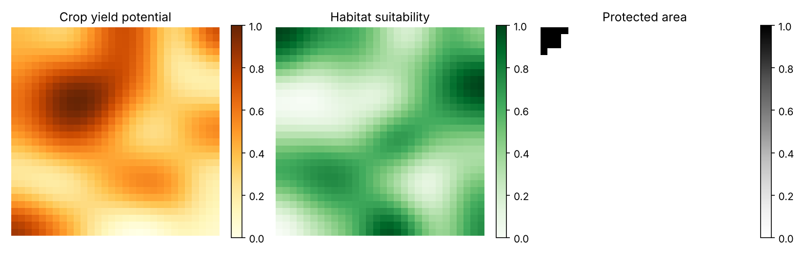
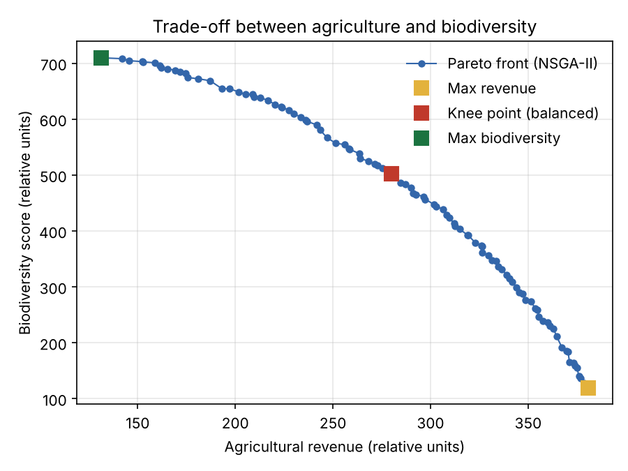
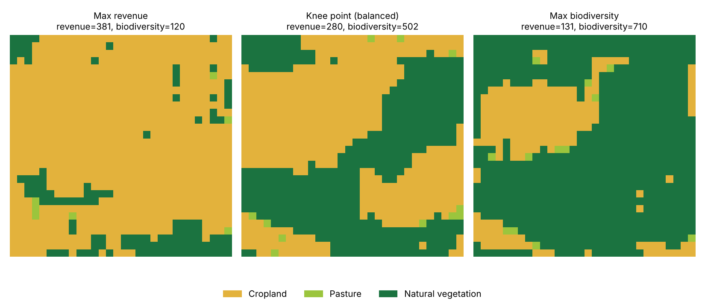
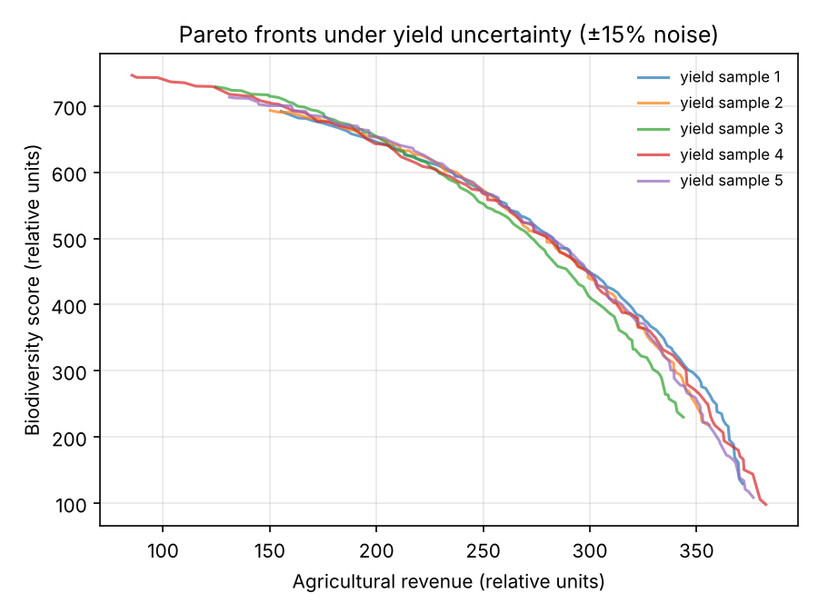
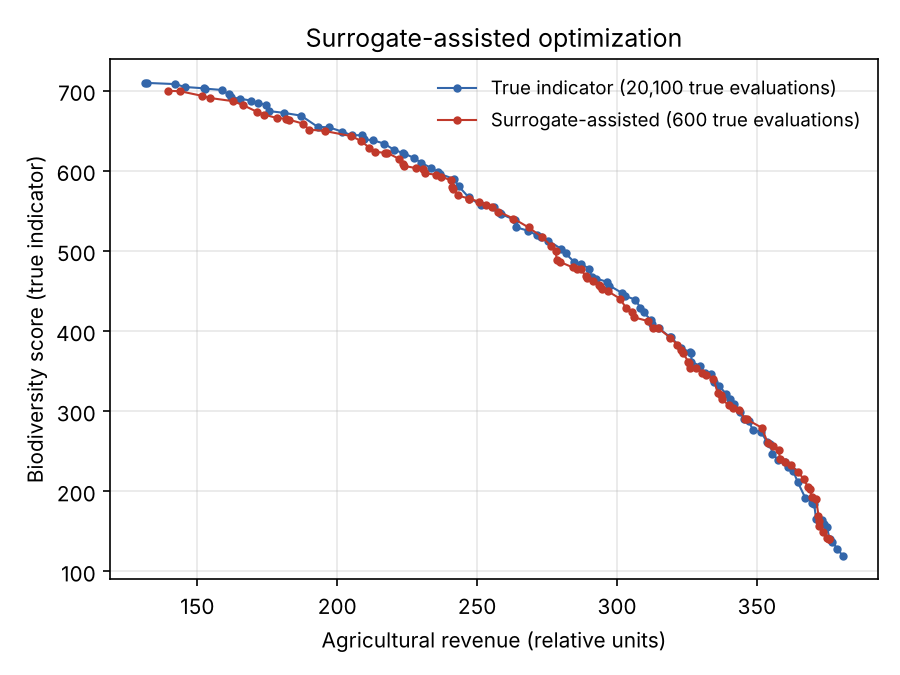
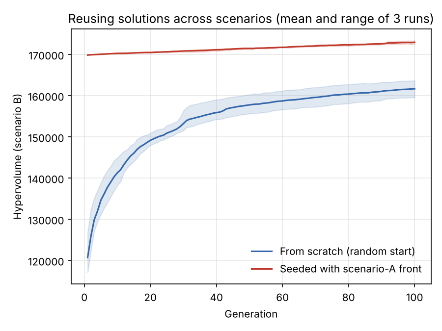

# Land Use Pareto Demo

A small learning prototype of **multi-objective spatial optimization of land use**. It uses an NSGA-II implemented from scratch (without an optimization library) on a synthetic raster landscape.

The goal was to understand, hands-on, how Pareto frontiers show trade-offs between agricultural production and biodiversity conservation. This is not a calibrated model. All data are synthetic and the indicators are deliberately simple.

*This prototype was developed with the help of an AI coding assistant, as a learning exercise.*

## Problem

- **Landscape:** a 30 × 30 raster. Each cell is assigned one of three land uses: cropland, pasture or natural vegetation.
- **Inputs:** spatially autocorrelated synthetic maps of crop yield potential and habitat suitability, plus a protected area that must stay natural (constraint).
- **Objective 1 – Agricultural revenue (maximize):** yield × price, summed over cropland and pasture cells.
- **Objective 2 – Biodiversity score (maximize):** habitat suitability of natural cells, with a bonus for natural neighbours. This rewards compact patches and penalizes fragmentation. Pasture keeps a small share of habitat value.



## Method

NSGA-II (Deb et al., 2002) implemented from scratch in `src/nsga2.py`:

- fast non-dominated sorting and crowding distance;
- binary tournament selection and elitist survival;
- **spatial operators:**
  - **block crossover:** swaps a rectangular area between two parent maps;
  - **neighbour-based mutation:** a cell copies the land use of a neighbouring cell. Both keep solutions spatially coherent;
- a repair step that enforces the protected-area constraint.

## Results

The Pareto front shows the trade-off clearly. Gaining agricultural revenue costs increasingly more biodiversity towards the right end of the front.



Three solutions from the front: maximum revenue, the knee point (closest to the ideal point after normalization) and maximum biodiversity.



### Simple uncertainty test

The yield map was perturbed with ±15% random noise (5 samples), and the optimization was re-run for each sample. The fronts stay similar in the balanced middle part, and they diverge more at the high-revenue end, which depends most on the yield values.

Some of the spread also comes from the stochastic optimizer itself (different random seeds and a limited number of generations). A proper analysis would need more samples and repeated runs, as in Hildemann & Verstegen (2021).



## Extension: can learning-based methods reduce the computational cost?

Computing Pareto fronts for many scenarios and uncertainty samples needs many optimization runs. Two very basic experiments explore ways to reduce this cost.

### Experiment 1 – Surrogate model for an "expensive" indicator (`src/surrogate_experiment.py`)

Indicators such as biodiversity often come from slow models (e.g. species distribution models). Here the biodiversity indicator is treated as expensive and every call is counted.

- **Baseline:** NSGA-II evaluates every candidate map with the true indicator.
- **Surrogate-assisted:** a ridge regression model learns the indicator from 300 true evaluations, using the one-hot land use map as input. NSGA-II then runs on the surrogate in three rounds. After each round, the final front is checked with the true indicator and added to the training data.

| | True indicator evaluations | Hypervolume |
|---|---|---|
| Baseline | 20,100 | 100% |
| Surrogate-assisted | 600 | 98.6% |

The surrogate-assisted front is almost identical while using about **33 times fewer** true evaluations. In this toy problem the "expensive" indicator is actually cheap, so wall-clock time does not change. The saving only matters when the real indicator is slow. The indicator here is also close to linear in the land use of each cell, which makes it easy to learn. Real indicators would likely need more flexible models (e.g. convolutional neural networks) and more training data.



### Experiment 2 – Reusing solutions across scenarios (`src/scenario_experiment.py`)

Scenario B is a simple "drier climate", in which crop yield drops by up to 40% from south to north. NSGA-II for scenario B is started either from random maps or from the Pareto front of scenario A (seeding).

The seeded runs start at a higher hypervolume than the random-start runs reach after 100 generations (mean of 3 runs).



This comparison is not a fair cost comparison: the seeded runs reuse the 200 generations already spent on scenario A. The point is that, when many related scenarios must be optimized, earlier results can be reused instead of starting from zero each time. This is plain seeding, not machine learning. A learning-based version, for example a model conditioned on scenario or stakeholder weights that directly proposes good maps, is a natural next step.

## Limitations and possible next steps

- Synthetic data and simplified indicators. Real indicators would come from, for example, species distribution models and yield or price data.
- A full Monte Carlo over input uncertainty is costly. More efficient approaches exist (e.g. exterior sampling with seeding).
- Comparison with a library implementation (e.g. pymoo) and with other algorithms.

## Run

```bash
pip install -r requirements.txt
python src/run.py                      # full run (~4 min)
python src/run.py --skip-uncertainty   # without the uncertainty test (~1 min)
python src/surrogate_experiment.py     # experiment 1 (~2 min)
python src/scenario_experiment.py      # experiment 2 (~3.5 min)
```

## References

- Deb, K., Pratap, A., Agarwal, S., & Meyarivan, T. (2002). A fast and elitist multiobjective genetic algorithm: NSGA-II. *IEEE Transactions on Evolutionary Computation*, 6(2), 182–197.
- Hildemann, M., & Verstegen, J. A. (2021). Quantifying uncertainty in Pareto fronts arising from spatial data. *Environmental Modelling & Software*.
